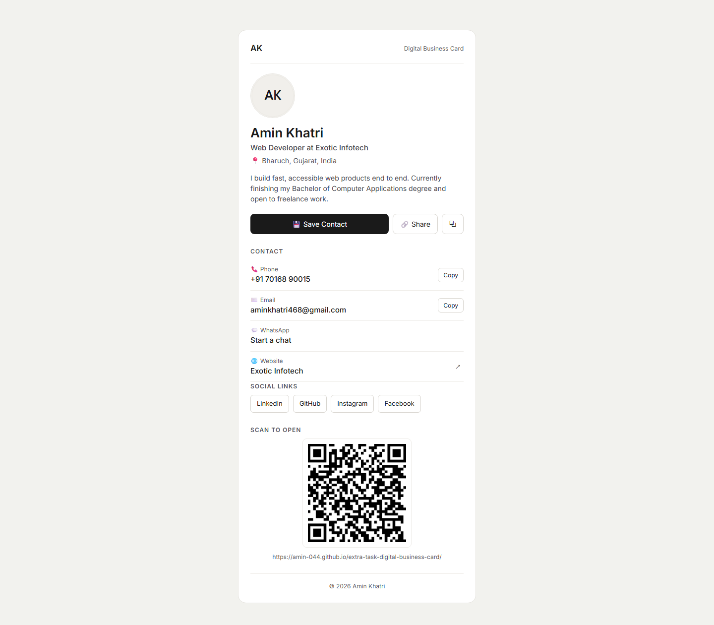
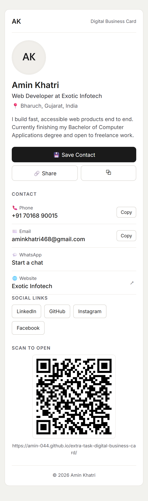

# AK — Digital Business Card

A simple digital business card for **Amin Khatri**, Web Developer at Exotic Infotech, Bharuch.
Built with plain HTML, CSS and JavaScript — no frameworks and no build step.

**Live site:** https://amin-044.github.io/extra-task-digital-business-card/

## Screenshots

### Desktop



### Mobile



## Features

- **Profile** — photo, name, role and short bio
- **Contact** — phone, email, WhatsApp and website links
- **Social links** — LinkedIn, GitHub, Instagram and Facebook
- **Save Contact** — downloads a `.vcf` file that adds me to your phone contacts
- **Copy buttons** — copy the phone number, email or the card link
- **Share** — uses the phone's share sheet on mobile, copies the link on desktop
- **QR code** — scan it to open this page on another device
- **Toast messages** — small confirmation at the bottom after copy / share / save
- **Responsive** — works on desktop and small phones (tested from 320 px up)

## Built with

- HTML5
- CSS3 (flexbox, media queries)
- Vanilla JavaScript (`var`, `onclick`, no libraries besides the QR code)
- [qrcodejs](https://github.com/davidshimjs/qrcodejs) — bundled locally in `vendor/qrcode.min.js`

## Project structure

```
.
├── index.html            # page markup, meta tags and links
├── style.css             # all styling and responsive rules
├── script.js             # copy, share, vCard and QR code logic
├── favicon.svg           # small "AK" tab icon
├── assets/
│   ├── avatar.svg        # profile photo
│   └── og-cover.png      # 1200x630 image for WhatsApp / Facebook previews
├── vendor/
│   └── qrcode.min.js     # QR code library (local copy)
└── screenshots/
    ├── desktop.png
    └── mobile.png
```

## Run it locally

You can just open `index.html` in a browser, but the QR code stays disabled there
because a `file:///C:/...` address cannot be opened from a phone.

For a proper preview, start a small local server in this folder:

```bash
python -m http.server 4173
```

Then open http://127.0.0.1:4173/

## How the QR code works

The QR code is created from the page's own address, so it never needs a hardcoded domain:

```js
function getPageLink() {
  var link = window.location.href.split("#")[0];
  link = link.split("?")[0];
  return link;
}
```

- Open the **deployed** URL and the QR encodes that exact URL.
- `#hash` and `?query` parts are removed, so tracking links don't end up in the QR.
- The QR is generated at 400 px and shown at 198 px, which keeps it sharp and easy to scan.
- On a local file (`file://`) the card shows a note instead of a broken QR code.
- If the QR library fails to load, a message is shown instead of an empty box.

I tested the generated QR with a decoder (jsQR) on the live GitHub Pages URL and it
opened exactly `https://amin-044.github.io/extra-task-digital-business-card/`.

## Customise it

1. **Name, role, bio** — edit the text in `index.html`.
2. **Phone, email, WhatsApp, website** — update the links in `index.html` and also
   `phoneNumber` / `emailAddress` at the top of `script.js` (they are used by the
   copy buttons and the `.vcf` file).
3. **Social links** — change the `href` values in the "Social Links" section.
4. **Colors and spacing** — all styles are in `style.css`.
5. **Link preview** — replace `assets/og-cover.png` (1200x630) and update the
   `og:image` URL in `index.html` if the site address changes.

## Deploy on GitHub Pages

1. Push this folder to a GitHub repository.
2. Go to **Settings → Pages**.
3. Under *Build and deployment*, choose **Deploy from a branch**.
4. Select branch **main** and folder **/ (root)**, then **Save**.
5. Wait a minute, then open `https://<username>.github.io/<repo-name>/`.

Because the QR reads the current page URL, it starts working as soon as the site is
live — no code changes needed after deployment.

## Author

**Amin Khatri**
Web Developer at Exotic Infotech
Bharuch, Gujarat, India

- Email: aminkhatri468@gmail.com
- Phone: +91 70168 90015
- GitHub: [@Amin-044](https://github.com/Amin-044)
